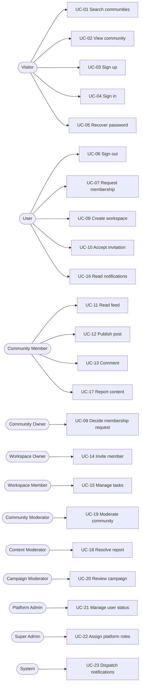

# Spark use cases

## Purpose

This document specifies the MVP use cases behind the stories in [user-stories.md](user-stories.md). Each use case names its actor, preconditions, main flow, alternative and failure flows, postconditions, and the business rules that backend use cases must enforce. Routes come from [screen-flow.md](screen-flow.md). Status is repeated from the stories and describes verified repository state only.

## Actor-to-use-case map

Role hierarchy notes: a Community Member and a Workspace Member are Users with extra scoped roles. Platform roles are independent of community or workspace roles. No platform role implies tenant data access.

## Use case summary

| ID | Name | Primary actor | Story | Status |
| --- | --- | --- | --- | --- |
| UC-01 | Search communities | Visitor | US-B1, US-B2 | Mockup |
| UC-02 | View community | Visitor | US-B3 | Mockup |
| UC-03 | Sign up | Visitor | US-A4 | Planned |
| UC-04 | Sign in | Visitor | US-A1, US-A2 | Implemented (password), Mockup (OAuth) |
| UC-05 | Recover password | Visitor | US-A5 | Planned |
| UC-06 | Sign out and view session | User | US-A3 | Implemented |
| UC-07 | Request membership | User | US-C1, US-C3 | Planned |
| UC-08 | Create workspace | User | US-E1 | Mockup |
| UC-09 | Decide membership request | Community Owner | US-C2 | Planned |
| UC-10 | Accept workspace invitation | User | US-E3 | Planned |
| UC-11 | Read community feed | Community Member | US-D1 | Planned |
| UC-12 | Publish post | Community Member | US-D2, US-D4 | Planned |
| UC-13 | Comment on post | Community Member | US-D3 | Planned |
| UC-14 | Invite workspace member | Workspace Owner | US-E2 | Planned |
| UC-15 | Manage tasks | Workspace Member | US-E4, US-E5 | Mockup |
| UC-16 | Read and clear notifications | User | US-F1, US-F2 | Mockup |
| UC-17 | Report content | Reporter | US-G1 | Planned |
| UC-18 | Resolve report | Content Moderator | US-G2, US-G3 | UI implemented, backend not verified |
| UC-19 | Moderate community | Community Moderator | US-H1, US-G3 | UI implemented, backend not verified |
| UC-20 | Review sponsored campaign | Campaign Moderator | US-H2, US-G3 | UI implemented, backend not verified |
| UC-21 | Manage user status | Platform Admin | US-H3, US-G3 | UI implemented, backend not verified |
| UC-22 | Assign platform roles | Super Admin | US-H4 | Schema implemented, API not verified |
| UC-23 | Dispatch notifications | System | US-F1 | Planned |

Common rule for every authenticated use case: the session is validated first; authorization is checked per resource in the application use case; failures return a safe error that does not reveal hidden resources.

---

## Discovery

### UC-01: Search communities

- **Actor**: Visitor (also User)
- **Trigger**: Opens `/communities` or changes a filter.
- **Preconditions**: None.
- **Main flow**:
  1. The actor enters an optional keyword and optional topic, location, and stage filters.
  2. The system validates filters and page size.
  3. The system queries public communities with indexed PostgreSQL queries in deterministic order.
  4. The system returns one page and a cursor.
  5. The actor opens a result (UC-02).
- **Alternative flows**:
  - A1: No match. The system shows an empty state with a clear-filters action.
  - A2: Next page. The actor supplies the cursor; the system returns the next page without duplicates or gaps.
- **Failure flows**:
  - F1: Invalid filter value or oversized page size. The system returns a validation error.
  - F2: Cache or Redis unavailable. The system reads from PostgreSQL.
- **Postconditions**: No state changes.
- **Business rules**:
  - Only public communities are returned.
  - Only public results may be cached; cache keys include visibility scope, with TTL and post-commit invalidation.
  - A separate search engine requires evidence that PostgreSQL is insufficient.

### UC-02: View community

- **Actor**: Visitor, User
- **Trigger**: Opens `/communities/[slug]`.
- **Preconditions**: A community with that slug exists.
- **Main flow**:
  1. The system loads the community by slug.
  2. The system applies the visibility rule for the actor.
  3. The system shows description, topics, location, stage, activity summary, and the primary action Request access (UC-07).
- **Alternative flows**:
  - A1: Actor is already a member. The primary action becomes Open feed (UC-11).
  - A2: Actor has a pending request. The page shows the pending state.
- **Failure flows**:
  - F1: Hidden community or missing slug. The system returns `404` with identical output for both.
- **Postconditions**: No state changes.
- **Business rules**: Private communities expose only a public summary to non-members.

## Authentication and account access

### UC-03: Sign up

- **Actor**: Visitor
- **Trigger**: Submits `/signup`.
- **Preconditions**: Not signed in.
- **Main flow**:
  1. The actor submits email and password.
  2. The system validates format and password policy.
  3. The system hashes the password with Argon2id and stores the user.
  4. The system creates a session and returns the user.
- **Alternative flows**:
  - A1: Email verification is required. The system sends a single-use expiring link and the account stays restricted until verified.
- **Failure flows**:
  - F1: Email already registered. The response does not disclose existence.
  - F2: Weak password or invalid email. The system returns a validation error.
  - F3: Rate limit exceeded. The system returns `429` with `Retry-After`.
- **Postconditions**: One user row exists per unique email, even after retries.
- **Business rules**: Passwords and tokens never appear in logs.

### UC-04: Sign in

- **Actor**: Visitor
- **Trigger**: Submits `/login` with email and password, or chooses GitHub or Google.
- **Preconditions**: Not signed in.
- **Main flow** (password, `POST /api/v1/auth/password/sign-in`):
  1. The actor submits credentials.
  2. The system applies the route rate limit.
  3. The system verifies the Argon2id hash.
  4. The system creates an opaque session, stores its SHA-256 hash, and sets a secure cookie.
  5. The actor is redirected to the requested destination.
- **Alternative flows**:
  - A1: OAuth. The provider returns a verified email; the system signs in or creates the matching user after confirmation. Status: Mockup.
- **Failure flows**:
  - F1: Invalid credentials. One generic error; timing is comparable for unknown and known emails.
  - F2: Suspended account. Sign-in is refused with a safe message.
  - F3: Rate limit exceeded. `429` with `Retry-After`.
- **Postconditions**: Exactly one active session for this sign-in; any previous identifier is rotated.
- **Business rules**: Sessions are opaque; only the hash is stored; cookies are secure and HTTP-only.

### UC-05: Recover password

- **Actor**: Visitor
- **Trigger**: Submits `/forgot-password`.
- **Preconditions**: None.
- **Main flow**:
  1. The actor submits an email.
  2. The system responds identically regardless of account existence.
  3. If the account exists, the system sends an expiring single-use reset link with a hashed token.
  4. The actor sets a new password through the link.
  5. The system revokes all existing sessions for the account.
- **Failure flows**:
  - F1: Expired or used token. The system shows a safe error and offers a new request.
  - F2: Rate limit exceeded. `429` with `Retry-After`.
- **Postconditions**: The password hash is replaced and old sessions are revoked.
- **Business rules**: Tokens are stored only as hashes.

### UC-06: Sign out and view session

- **Actor**: User
- **Trigger**: Requests `GET /api/v1/me` or `POST /api/v1/auth/sign-out`.
- **Preconditions**: Valid session.
- **Main flow**:
  1. For profile: the system returns identity and roles with `private, no-store`.
  2. For sign-out: the system revokes the session server-side and clears the cookie.
- **Failure flows**:
  - F1: Missing, expired, or revoked session. `401`.
- **Postconditions**: After sign-out the session cannot be reused.

## Membership and community content

### UC-07: Request membership

- **Actor**: User
- **Trigger**: Chooses Request access on a private community.
- **Preconditions**: Community exists and accepts requests; actor is not a member and has no pending request.
- **Main flow**:
  1. The actor opens `/communities/[slug]/request` and optionally adds a message.
  2. The system authenticates the actor and validates the input.
  3. The system creates a pending request, protected by a uniqueness constraint on community and user.
  4. The system shows `/communities/[slug]/request/sent`.
  5. The system records an event for UC-23 in the same transaction.
- **Alternative flows**:
  - A1: Visitor is signed out. The system redirects to sign-in and then returns to the request screen.
  - A2: Duplicate retry. The system returns the existing request without creating another.
- **Failure flows**:
  - F1: Already a member. The system shows the current state.
  - F2: Cooldown after rejection. The system explains when the actor may retry.
- **Postconditions**: At most one pending request exists per community and user.
- **Business rules**: Uniqueness and state transitions are enforced transactionally and by constraints.

### UC-09: Decide membership request

- **Actor**: Community Owner
- **Trigger**: Approves or rejects a pending request.
- **Preconditions**: The actor owns the community; the request is pending.
- **Main flow**:
  1. The actor opens the pending request list.
  2. The actor selects a request and chooses Approve or Reject.
  3. The system locks the request row, verifies it is still pending, and applies the transition.
  4. On approval the system creates the membership in the same transaction.
  5. The system records an event for UC-23.
- **Failure flows**:
  - F1: Actor is not an owner. `403`; the list stays hidden.
  - F2: Request already decided. Conflict; nothing changes.
- **Postconditions**: The request is approved with a membership, or rejected without one. Never both states.
- **Business rules**: Pending to approved or rejected is the only allowed transition.

### UC-11: Read community feed

- **Actor**: Community Member
- **Trigger**: Opens the community feed.
- **Preconditions**: The actor can view the community.
- **Main flow**:
  1. The system checks membership and visibility.
  2. The system returns posts newest first with a cursor.
- **Failure flows**:
  - F1: Not authorized. `403` or `404` consistent with the visibility rule.
- **Business rules**: List and detail endpoints share one visibility rule. Cache entries, if any, are keyed by tenant and visibility scope.

### UC-12: Publish post

- **Actor**: Community Member
- **Trigger**: Submits the create post form.
- **Preconditions**: Active membership; community not frozen or archived.
- **Main flow**:
  1. The actor submits title and body with an idempotency key.
  2. The system validates length and content and checks membership.
  3. The system stores the post and returns it.
- **Alternative flows**:
  - A1: Retry with the same key. The system returns the original post.
  - A2: Author edits or deletes later. Allowed only for the author within policy.
- **Failure flows**:
  - F1: Validation error. Nothing is stored.
  - F2: Frozen community. The system rejects the post with a clear reason.
- **Postconditions**: One post per idempotency key.

### UC-13: Comment on post

- **Actor**: Community Member
- **Trigger**: Submits a comment on a post detail page.
- **Preconditions**: The actor can view the post.
- **Main flow**:
  1. The actor submits a comment with an idempotency key.
  2. The system validates and authorizes.
  3. The system stores the comment and records an event for UC-23 to notify the post author.
- **Failure flows**:
  - F1: Membership lost or post removed. The system rejects with `403` or `404`.
- **Postconditions**: One comment per idempotency key.

## Workspaces and tasks

### UC-08: Create workspace

- **Actor**: User
- **Trigger**: Submits workspace creation.
- **Preconditions**: Signed in.
- **Main flow**:
  1. The actor submits a workspace name.
  2. The system validates the name.
  3. In one transaction the system creates the tenant, the workspace, and the owner membership.
  4. The actor lands on `/workspace`.
- **Failure flows**:
  - F1: Any step fails. The transaction rolls back; no partial workspace exists.
- **Postconditions**: A workspace with exactly one owner exists.
- **Business rules**: Tenant-scoped tables carry `tenant_id`; RLS is tested with two tenants and reused pooled connections.

### UC-14: Invite workspace member

- **Actor**: Workspace Owner
- **Trigger**: Submits an invitation email.
- **Preconditions**: Actor owns the workspace.
- **Main flow**:
  1. The actor enters the recipient's email.
  2. The system creates an invitation with a hashed token and an expiry.
  3. The system sends the invitation through a post-commit outbox.
- **Alternative flows**:
  - A1: Owner revokes a pending invitation. It can no longer be accepted.
- **Failure flows**:
  - F1: Non-owner actor. `403`.
  - F2: Duplicate pending invitation for the same email. The system returns the existing one.
- **Business rules**: Invitations are expiring and single-use.

### UC-10: Accept workspace invitation

- **Actor**: User
- **Trigger**: Opens the invitation link.
- **Preconditions**: Valid, unexpired, unused token; actor signed in as the intended recipient.
- **Main flow**:
  1. The system loads the invitation by token hash and locks it.
  2. The system verifies recipient, tenant, and status.
  3. The system creates the workspace membership and marks the invitation used in one transaction.
  4. The actor lands on `/workspace`.
- **Failure flows**:
  - F1: Expired, used, or revoked. Safe error.
  - F2: Wrong account. Refused; no information about the intended recipient is revealed.
  - F3: Concurrent accepts. Exactly one succeeds.
- **Postconditions**: One membership; invitation consumed.

### UC-15: Manage tasks

- **Actor**: Workspace Member
- **Trigger**: Adds, assigns, or moves a task on `/workspace`.
- **Preconditions**: Active workspace membership.
- **Main flow**:
  1. The actor creates a task or selects an existing one.
  2. The actor sets assignee or state; the request carries the task version.
  3. The system verifies tenant membership and that the assignee belongs to the same workspace.
  4. The system applies a conditional update and increments the version.
- **Alternative flows**:
  - A1: Keyboard or touch move. Same contract, accessible controls.
- **Failure flows**:
  - F1: Stale version. Conflict; the client shows the latest state.
  - F2: Assignee outside workspace. Validation error.
  - F3: Cross-tenant access. Resource appears missing.
- **Postconditions**: No silent overwrites.

## Notifications

### UC-16: Read and clear notifications

- **Actor**: User
- **Trigger**: Opens `/notifications`.
- **Preconditions**: Signed in.
- **Main flow**:
  1. The client polls for the actor's notifications.
  2. The system rechecks authorization for each linked resource.
  3. The actor chooses Mark all as read; the system marks only the actor's items.
- **Alternative flows**:
  - A1: Access to a resource was lost. The system omits or redacts that notification.
- **Postconditions**: Marking read is idempotent.

### UC-23: Dispatch notifications

- **Actor**: System
- **Trigger**: A committed domain event appears in the outbox.
- **Preconditions**: Event committed with its originating change.
- **Main flow**:
  1. The dispatcher reads unprocessed outbox rows in order.
  2. The system creates notification rows for authorized recipients.
  3. The system marks the outbox row processed.
- **Failure flows**:
  - F1: Dispatcher crash. Rows remain unprocessed and are retried; processing is idempotent.
- **Business rules**: The outbox exists because a post-commit side effect exists. Realtime delivery is added only when polling proves insufficient.

## Moderation and governance

### UC-17: Report content

- **Actor**: Reporter (Community Member or User who can view the content)
- **Trigger**: Chooses Report on a post or comment.
- **Preconditions**: The actor can view the target.
- **Main flow**:
  1. The actor picks a reason and optional detail.
  2. The system validates and authorizes.
  3. The system creates the report, unique per reporter and target.
  4. The system confirms receipt without showing the reporter to other members.
- **Failure flows**:
  - F1: Duplicate report. The system returns the existing report.
  - F2: Target not visible. `404`.
- **Business rules**: Reporter identity is visible only to authorized moderators.

### UC-18: Resolve report

- **Actor**: Content Moderator
- **Trigger**: Opens the Reports queue in `/admin`.
- **Preconditions**: Role `content_moderator` with scope covering the report.
- **Main flow**:
  1. The system lists only reports inside the actor's scope.
  2. The actor opens a report and chooses Dismiss or Take action.
  3. In one transaction the system updates the report, applies any content change, and writes the moderation record with actor, target, reason, and timestamp.
  4. The system records an event for UC-23.
- **Failure flows**:
  - F1: Report outside scope. `404`.
  - F2: Already resolved. Conflict.
- **Postconditions**: A moderation record exists for every action.

### UC-19: Moderate community

- **Actor**: Community Moderator
- **Trigger**: Chooses Feature, Freeze, or Archive in `/admin` (Communities).
- **Preconditions**: Role `community_moderator`.
- **Main flow**:
  1. The actor selects a community and an action and enters a reason.
  2. The system validates the state transition.
  3. The system updates status and writes the moderation record in one transaction.
- **Failure flows**:
  - F1: Missing role. `403`.
  - F2: Invalid transition. Validation error.
- **Business rules**: Frozen communities reject new posts and comments; archived communities are read-only.

### UC-20: Review sponsored campaign

- **Actor**: Campaign Moderator
- **Trigger**: Opens the Campaigns queue in `/admin`.
- **Preconditions**: Role `campaign_moderator`; campaign pending.
- **Main flow**:
  1. The actor reviews the promotion.
  2. The actor approves or rejects with a reason.
  3. The system updates the campaign and writes the moderation record.
- **Failure flows**:
  - F1: Already decided. Conflict.
- **Business rules**: Campaign decisions are auditable and final unless a reopen action is specified.

### UC-21: Manage user status

- **Actor**: Platform Admin
- **Trigger**: Chooses Suspend or Reactivate in `/admin` (Users).
- **Preconditions**: Role `platform_admin`.
- **Main flow**:
  1. The actor selects a user and a status change with a reason.
  2. On suspend, the system revokes all of the user's sessions and blocks sign-in.
  3. The system writes the moderation record.
- **Failure flows**:
  - F1: Target is a `super_admin`. The system refuses unless the actor is also `super_admin`.
- **Postconditions**: Suspension takes effect on the next request.

### UC-22: Assign platform roles

- **Actor**: Super Admin
- **Trigger**: Audits or changes roles in `/admin` (Users).
- **Preconditions**: Role `super_admin`.
- **Main flow**:
  1. The actor views a user's platform roles.
  2. The actor grants or revokes a role.
  3. The system writes the change and an audit record in one transaction.
- **Failure flows**:
  - F1: Revoking the last `super_admin`. Refused.
  - F2: Non-super-admin actor. `403`.

---

## Cross-cutting rules

| Rule | Applies to |
| --- | --- |
| Opaque session validated before authorization | All authenticated use cases |
| Per-resource authorization in the application layer, tenant filtering in database access | UC-07 to UC-22 |
| Idempotency keys on mutations that retries can duplicate | UC-07, UC-12, UC-13, UC-17 |
| Version or conditional update for concurrent edits | UC-15 |
| Transaction wraps state change, moderation record, and outbox event | UC-07, UC-09, UC-10, UC-18 to UC-22 |
| Route-specific rate limits with `429` and `Retry-After` | UC-03, UC-04, UC-05, UC-07 |
| Hidden resources return `404` indistinguishable from missing | UC-02, UC-11, UC-17 |
| No secrets or private payloads in logs | All |

## Verification notes

- Statuses were taken from [context.md](../context.md) and [screen-flow.md](screen-flow.md); no code or API behavior was executed to produce this document.
- Governance use cases (UC-18 to UC-22) have `/admin` UI per screen-flow.md. Backend endpoints, authorization, and audit persistence for them were not verified.
- Post-MVP work (mentor matching, file uploads, rich realtime collaboration, AI summaries, billing upgrades) has no use cases here.
